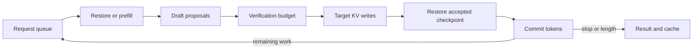

# Core DeepInfer

**Follow a request from prefill to the last committed token.**

[中文](README_CN.md) · [PyPI](https://pypi.org/project/core-deepinfer/) · [Read the source](core_deepinfer/guides/00-index_EN.md) · [Upstream source map](docs/SOURCE_MAP.md) · [Validation](docs/VALIDATION.md)

A small NumPy inference engine for studying DeepInfer's state transitions. Submit requests, restore a cached prefix, propose draft tokens, allocate verification work, write real KV, roll back a rejected branch, and keep generating. The same loop is available as a Python library and a CLI.

The default demo uses the actual request loop, not a scripted response or a separate implementation. Its trace records the restore, verification and commit events that really happened.

The model performs real float64 attention, projections and feed-forward operations. Its parameters are **random and untrained**. Token IDs are not useful language output, and this project does not load DeepSeek weights. The purpose is to make inference state inspectable, not to squeeze a production model onto a laptop.

## Run the complete loop first

Python 3.10+ and NumPy. No model download, GPU, API key or service.

```bash
python -m pip install core-deepinfer
core-deepinfer
core-deepinfer guide --list
```

The published package includes the complete bilingual guide text. Use `core-deepinfer guide 03` or `core-deepinfer guide 03 --lang zh` to read a chapter offline. The full tests and examples are available in the source checkout below.

The default run exercises two requests with a shared prefix, a cancelled request, speculative writes and rollback, a hot state hit, an expired short state with a surviving encoder prefix, and finally a cold miss. It checks emitted tokens **and the complete committed state** against ordinary greedy decoding.


Rendered from actual CLI stdout by `python examples/render_demo.py`. The raw numerical record is also available in [engine-demo.json](docs/results/engine-demo.json).

The expiry clock is injected, so the demo does not actually sleep for 200 seconds. Its cost curve is synthetic. Query-row counters describe work that ran; they are not GPU timings, FLOPs or a speedup.

```bash
python -m core_deepinfer demo --trace
python -m core_deepinfer demo --trace --json
python -m pytest -q
```

## Use the engine, then read it

```python
from core_deepinfer import Engine, EngineConfig, TinyModel

target = TinyModel(seed=7)
draft = TinyModel(seed=8, depth=1)
engine = Engine(target, draft, config=EngineConfig(max_batch_tokens=8))

first = engine.submit([1, 2, 3, 4], max_tokens=8)
second = engine.submit([1, 2, 3, 4, 5], max_tokens=5)

for result in engine.run():
    print(result.request_id, result.tokens, result.finish_reason)

# Reuse the same engine and cache for the next request.
result = engine.generate([1, 2, 3, 4], max_tokens=4)
print(engine.metrics())
```

Call `step()` instead of `run()` to inspect each budget and commit event. `cancel(request_id)` works before admission or between steps. `run()` returns newly completed results once; `result(request_id)` keeps them addressable. A failed request is explicit: healthy peers drain, then `RequestError.results` carries the batch. Previously reported failures do not poison later requests.

`examples/engine_batch.py` runs these APIs and checks their outputs.

## What is actually connected

| Component | Behavior in the engine |
| --- | --- |
| Model | Causal encoder, projected shared source KV and layered local-attention consumers; incremental decode retains the shared projections |
| Local state | Each consumer's actual keys and values pass through position-tagged rings; the next forward reads those rings |
| Verification | Draft and target both execute real forwards. Verification writes the selected drafts, restores the accepted checkpoint, and commits only replacement or bonus tokens |
| Recovery | A hot hit restores the complete cursor. A warm hit reuses encoder/source KV and replays consumers. A cold miss performs prefill. A longer prompt can extend a stored shorter prefix |
| Scheduler | Round-robin request interleaving with a bounded useful-token budget, ragged draft availability, EOS, cancellation and explicit errors |
| Budget | Previous confidence selects a total; current confidence redistributes that same total. The resulting lengths control how many draft positions the target actually verifies |

This is sequential NumPy execution, not parallel GPU batching. Draft self-probability is a visible scheduling heuristic, not DSpark's learned acceptance confidence. Checkpoints copy arrays instead of using a production allocator or an optimized undo log.

## The execution path



Start with [`Engine.step`](core_deepinfer/engine.py), then follow a single verification into [`Runner.verify`](core_deepinfer/runtime.py). The readable unit is a request's lifetime, not a list of unrelated features.

## Code map and walkthroughs

| File | What to follow |
| --- | --- |
| [`engine.py`](core_deepinfer/engine.py) | Admission, recovery, budget, commit, cancellation and terminal results |
| [`runtime.py`](core_deepinfer/runtime.py) | Real KV rings, snapshots, draft proposals and reversible target verification |
| [`model.py`](core_deepinfer/model.py) | Full versus incremental attention, encoder/source sharing and consumer replay |
| [`cache.py`](core_deepinfer/cache.py) | Exact prefix keys, independent TTLs, copy isolation and ring contents |
| [`budget.py`](core_deepinfer/budget.py) | Survival probabilities, ragged availability, graph padding and budget conservation |
| [`demo.py`](core_deepinfer/demo.py) | The complete engine under an injected clock, checked against a separate oracle |
| [`speculative.py`](core_deepinfer/speculative.py) | The simple recomputing oracle, kept for comparison rather than used by the engine |

The [bilingual source-reading series](core_deepinfer/guides/00-index_EN.md) follows the loop, state recovery, speculative transactions, scheduling, numerical model and extension points. Each part links runnable tests and a change worth trying. Longer walkthroughs of the original DeepInfer implementation live in [AI Infra Notes](https://github.com/he-yufeng/ai-infra-notes).

## Run your own request batch

```bash
python -m core_deepinfer generate --prompt 1,2,3,4 --max-tokens 12 --trace
python -m core_deepinfer generate --prompt 1,2,3 --prompt 4,5,6 --batch-budget 4 --json
python -m core_deepinfer generate --input examples/requests.json --greedy --json
```

Omit the draft model in the library, or use `--greedy`, for ordinary incremental decoding. Request files contain token IDs and limits, not text prompts or executable tools.

For the smaller numerical detail experiments:

```bash
python -m core_deepinfer replay --length 32 --keep 8 --seed 7 --json
python -m core_deepinfer budget --json
python -m core_deepinfer cache --json
python -m core_deepinfer speculative --json
```

The default recovery is exact. Explicit `--recovery compact --keep 8` requests bounded recovery and may change outputs. Mask and compact can agree on the same bounded graph without agreeing with exact recovery. Both preserve the complete encoder source; fewer consumer rows do not mean the whole model does proportionally less work.

## Working on the source

To change the model or run the full test suite, install a source checkout:

```bash
git clone https://github.com/he-yufeng/core-deepinfer.git
cd core-deepinfer
python -m venv .venv
source .venv/bin/activate
python -m pip install -e '.[dev]'
python -m pytest -q
ruff check core_deepinfer tests examples
ruff format --check core_deepinfer tests examples
python -m build
```

The sdist includes tests and examples as well as the executable modules. A wheel built from it also includes all fourteen guide texts; installing a wheel is not a substitute for running the source tests.

The guides in `core_deepinfer/guides` are the same documents printed by the installed CLI, not a separately maintained copy.

## Validation and scope

[VALIDATION.md](docs/VALIDATION.md) records the tested environment, commands, source fingerprints and packaging checks. Tests compare cached generation with ordinary greedy decoding across seeds and windows, exercise overwritten-ring restoration, cold/hot/warm recovery, budget redistribution, ragged batches, failure isolation and engine reuse. Smaller allocation cases are checked against an exhaustive oracle.

Not implemented: trained DeepSeek models, MLA, MoE, mHC, quantization, CP, CUDA Graphs, GPU/NPU execution, distributed KV storage, persistent request sessions or an HTTP server. There is no production latency or model-quality claim. These are deliberate boundaries, not interchangeable evidence from the original project.

Original code and documentation are [MIT](LICENSE). Referenced upstream implementations retain their own licensing and attribution. Independent community project, not affiliated with or endorsed by DeepSeek.

If this helps you follow the state transitions, a Star is welcome. A small failing example is even more useful.
