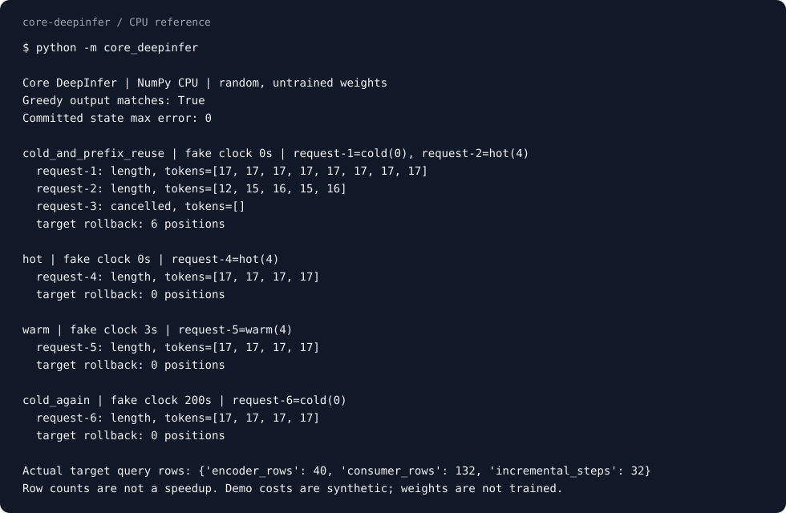
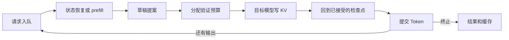

# Core DeepInfer

**沿着一个请求，读到最后一个真正提交的 Token。**

[English](README.md) · [源码导读系列](core_deepinfer/guides/00-index.md) · [原版源码映射](docs/SOURCE_MAP.md) · [验证记录](docs/VALIDATION.md)

推理框架最难读懂的，往往不是 attention 的公式。一个请求被抢占、命中旧状态、提出草稿又被拒绝以后，哪些数据还有效，下一轮从哪里接着算？

Core DeepInfer 把这条执行链写成了一个小型 NumPy 引擎：请求入队，恢复缓存或 prefill，生成草稿，分配验证预算，写入真实 KV，回滚被拒绝的分支，再继续生成。库接口、CLI 和默认 demo 走的是同一条链，不是几套互不相干的演示。

它对标 [CoreCoder](https://github.com/he-yufeng/CoreCoder) 的做法：**先让最小核心真正工作，再沿着实际代码讲清楚它。** CoreCoder 留下一个能改代码的 Agent 循环；这里留下一个能执行、恢复、拒绝和提交的推理循环。

## 先把边界说清楚

这不是把 DeepSeek 大模型压缩到笔记本。模型使用随机初始化、未训练的参数，真实执行 float64 attention、投影和前馈计算，但没有语言能力，也不加载 DeepSeek 权重。

因此，输出 `[17, 17, 17]` 不是什么回答。它让我们检查：普通解码与缓存、投机执行是否留下了同样的 Token 和完整状态。预算曲线也是人为给出的输入，不能拿合成毫秒数当硬件性能。

## 五分钟，跑完一次请求生命周期

Python 3.10+，运行依赖只有 NumPy。不下载权重，不要 API key，也不启动服务。

```bash
git clone https://github.com/he-yufeng/core-deepinfer.git
cd core-deepinfer
python -m venv .venv
source .venv/bin/activate
python -m pip install -e '.[dev]'
core-deepinfer
core-deepinfer guide --list --lang zh
```

当前先从仓库安装，PyPI 版本尚未发布。安装包自带完整双语导读，`core-deepinfer guide 03 --lang zh` 会直接打印第三篇，不开浏览器，也不临时联网。完整测试、示例和验证记录都在这个 checkout 中，不另放一套只能看的演示。

默认 demo 不是把几个预写好的数字打印出来。它实际提交两个有共同前缀的请求，取消第三个请求，运行草稿与目标模型，再让同一前缀依次经历热命中、短状态过期后的恢复、完整过期后的冷启动。



图由 `python examples/render_demo.py` 直接捕获实际 CLI 输出生成，没有另一套演示数据。完整数值记录见 [engine-demo.json](docs/results/engine-demo.json)。

这里用了可注入时钟，不是真的等 200 秒。完整轨迹可以直接看：

```bash
python -m core_deepinfer demo --trace
python -m core_deepinfer demo --trace --json
python -m pytest -q
```

## 这次要读的是一条主链



可以从 [`Engine.step`](core_deepinfer/engine.py) 开始，在一次 `commit` 上打断点，再跟进 [`Runner.verify`](core_deepinfer/runtime.py)。你能看到被拒绝的位置确实已经覆盖了 ring，也能看到回滚怎样恢复内容，而不是只把一个游标减回去。

| 模块 | 现在真正参与了什么 |
| --- | --- |
| 模型 | 因果 Encoder、共享来源 KV、多层局部 consumer；新增 Token 只追加自己的投影，不重算整个共享 KV |
| 事务 | 草稿和目标模型都实际 forward；验证后只保留接受前缀，拒绝后恢复对应检查点，再提交替代 Token 或 bonus |
| 缓存 | 热命中恢复完整游标；短状态过期时重用 Encoder 来源、重放 consumer；全失效才 cold prefill；较短前缀可以接着扩展 |
| 调度 | 多请求轮转，预算不够时分轮处理；EOS、长度上限、取消和错误都有明确终态 |
| 预算 | 先用上一轮信息定总量，再用较新信息重新分配；分到的长度真的控制验证位置数，不只是报告字段 |
| 错误处理 | 某请求失败不会把其他请求的结果丢掉；同一个 Engine 在报告过失败后还能继续接新请求 |

这里仍然是顺序 NumPy 执行，不是 GPU 并行批处理。草稿模型的自概率是可观察的调度启发式，不冒充 DSpark 训练出的接受置信度。快照采用数组复制，不是生产 allocator 或高效 undo log。

## 当作库来用

```python
from core_deepinfer import Engine, EngineConfig, TinyModel

target = TinyModel(seed=7)
draft = TinyModel(seed=8, depth=1)
engine = Engine(target, draft, config=EngineConfig(max_batch_tokens=8))

first = engine.submit([1, 2, 3, 4], max_tokens=8)
second = engine.submit([1, 2, 3, 4, 5], max_tokens=5)

for result in engine.run():
    print(result.request_id, result.tokens, result.finish_reason)

# 同一个引擎继续用，缓存和后续请求都在同一条执行链里。
next_result = engine.generate([1, 2, 3, 4], max_tokens=4)
```

`step()` 只推进一轮，返回这一轮实际发生的事件；`cancel(id)` 可以在入队后或两轮之间取消请求。`run()` 每次返回尚未交付的新结果，历史结果仍可通过 `result(id)` 取回。错误默认在同批健康请求排空后通过 `RequestError.results` 明确报告，不返回一份悄悄缩短的成功列表。

完整可运行例子在 [`examples/engine_batch.py`](examples/engine_batch.py)。

## 给自己的输入跑一次

```bash
python -m core_deepinfer generate --prompt 1,2,3,4 --max-tokens 12 --trace
python -m core_deepinfer generate --prompt 1,2,3 --prompt 4,5,6 --batch-budget 4 --json
python -m core_deepinfer generate --input examples/requests.json --greedy --json
```

输入是 Token ID，不是文本指令。`--prompt` 可以重复，JSON 文件还可以给每个请求指定名字、长度和 EOS。库接口不传草稿模型，或 CLI 使用 `--greedy`，就是普通增量解码。

## 从能跑到读懂

[导读总入口](core_deepinfer/guides/00-index.md)按实际代码分六部分，中英文各自成篇：

1. 请求怎样走完一生：入队、调度、提交与终态。
2. 状态命中以后，到底省了哪一段计算。
3. 草稿已经写进 ring，拒绝之后怎样回滚。
4. 总预算不变，为何实际验证长度可以重新分配。
5. 用数值对照看懂共享来源、局部注意力与有限回放。
6. 从这里继续改：换策略、加测试、辨认刻意省略的生产能力。

原版 DeepInfer 的较长源码分析另放在 [AI Infra Notes](https://github.com/he-yufeng/ai-infra-notes)。这里负责把可修改的小实现走通，两者互相对照。

早期的独立细节算例仍然保留，可以用来拆开一个公式或索引问题：

```bash
python -m core_deepinfer replay --length 32 --keep 8 --json
python -m core_deepinfer budget --json
python -m core_deepinfer cache --json
python -m core_deepinfer speculative --json
```

默认恢复使用 exact。显式设置 `--recovery compact --keep 8` 才选择有界恢复，它可能改变后续输出。mask 与 compact 对齐，只能说明同一截断图的实现一致，不说明截断图与 exact 等价。完整 Encoder 来源仍然保留，consumer 少算几行也不代表整个模型按比例加速。

## 修改源码

完成前面的源码安装后，在仓库里运行检查：

```bash
python -m pytest -q
ruff check core_deepinfer tests examples
ruff format --check core_deepinfer tests examples
python -m build
```

构建出的 sdist 包含测试、示例和完整源码，不是只给一个能打印 demo 的 wheel。由它构建的 wheel 也会带上十四份导读；安装包能运行和源码测试通过，两项分别验证。

`core_deepinfer/guides` 里的文档就是 CLI 离线读取的那一份，没有另维护一套安装包导读。模型中的 Encoder/consumer 分工与运行时的 prefill/decode 是两个维度；这里两种执行阶段都有，不是一个只演示 decode 的算例。

## 验证与没有实现的部分

[验证记录](docs/VALIDATION.md)保存了实际环境、命令、源码指纹和安装包检查。测试包括多种 seed/window/草稿宽度下的完整状态对照，ring 覆写恢复，冷热与过期命中，预算重分配、不同请求长度、取消、错误隔离和 Engine 多批复用。小规模预算分配还用穷举结果作对照。

没有 DeepSeek 训练权重、MLA、MoE、mHC、量化、CP、CUDA Graph、GPU/NPU、多机 KV 存储、持久化请求会话或 HTTP 服务。没有生产吞吐、延迟或模型任务质量结论。项目规模小，省略的边界也应当看得见，不能用 mock 或别人的硬件成绩填上。

原创代码与文档采用 [MIT](LICENSE)，引用的原项目实现保留其来源和许可。独立社区项目，与 DeepSeek 没有官方隶属关系。

如果这条执行链帮你把源码读明白了，欢迎点个 Star。也欢迎带一个小反例来，把某条看似正确的状态转换真正跑坏。
